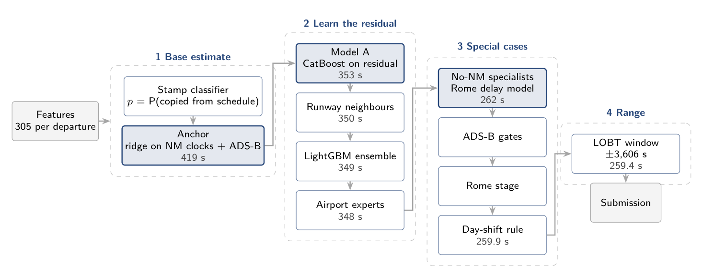
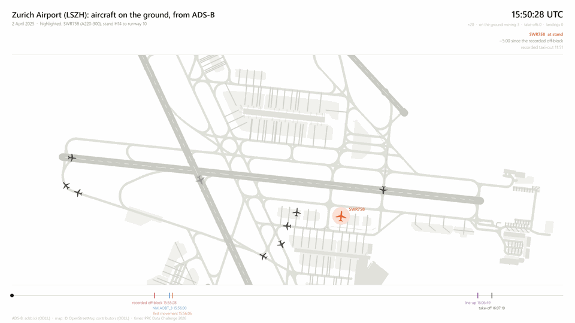

# strong-crane — PRC Data Challenge 2026

<p align="center"></p>

Taxi-out time (seconds) for departures at ten European airports, from the organiser's movement records and open data.
One notebook runs the whole process: inputs in, models trained, predictions out.

The report: [`paper/paper_final_phase.pdf`](paper/paper_final_phase.pdf).

## How it works

<p align="center"></p>

Each box is a stage; the grey number is the RMSE (s) on the held-out month (July 2025) after it.

1. **Inputs and features.** The notebook first checks that every input is there (and says how to get a missing one),
   then reads the pinned feature table or builds it from the raw inputs.
2. **Base estimate.** A classifier flags departures whose recorded off-block may be copied from the schedule; a ridge
   anchor combines the NM flight-plan clocks with the ADS-B ground evidence.
3. **Learn the residual.** CatBoost learns what the anchor misses, refined by runway neighbours, a LightGBM ensemble
   and airport experts.
4. **Special cases.** Specialists for departures without an NM record, ADS-B gates, the Rome stage and the day-shift
   rule.
5. **Range.** Predictions are kept within the LOBT window.
6. **Published daily totals.** EUROCONTROL publishes each airport's total pre-departure delay per day, which on 2025
   equals the sum over the day's departures of max(0, take-off − schedule − taxi-out). Each day's predictions are
   reconciled with that total, every departure of the day responds to the day's shift with a fitted loading, and a
   Rome or Istanbul departure without a flight plan whose flight has a plan at the destination is kept outside the
   window around that plan's off-block. 2025 out of fold: 230.9 → 228.6 s; on the ranking set the reconciliation alone takes 212.85 to 212.05 s, all three steps to 211.96 s, and the ensemble recomputed with the post-processed files reaches 211.73 s.

Every choice is made out of fold on contiguous month blocks of 2025; the stack is then refitted on all of 2025 and
predicts 2026.

## Final submission

`results/strong-crane_final.parquet` (670,790 departures, January, February, June and July 2026; SHA-256
`8776bb6cf4bbe9dfe0e539672cf762698dc0bf4c77f5b0c4339aabb703a8856b`).

`make final FINAL_ORGANISER=<folder>` rebuilds the whole file from `data/final_parts/` and checks its SHA-256.

## Quick start with Docker

The image holds the code and its Python environment (`ghcr.io/somnathab3/strong-crane`, built from this repository).
Put the inputs in one folder and mount it at `/data`:

```
<inputs>/raw/organiser/      training_2025-*.parquet, ranking.parquet, submitting.parquet
<inputs>/features/           features_f391f7893a3cde99.parquet (the pinned feature table)
<inputs>/raw/eurocontrol/    all_pre_departure_delays.parquet (step 6; skipped when absent)
<inputs>/raw/...  extra/     only to rebuild the features (see Inputs below)
```

```
docker run --rm --gpus all -v <inputs>:/data -v <out>:/app/results ghcr.io/somnathab3/strong-crane make smoke   # ~10 min
docker run --rm --gpus all -v <inputs>:/data -v <out>:/app/results ghcr.io/somnathab3/strong-crane make full    # ~12.5 h
```

Without a GPU add `-e V77_DEVICE=CPU`. Give Docker at least 24 GB of memory.

## Run without Docker

Python 3.12:

```
pip install -r requirements.txt
pip install -e .
cp configs/paths.example.json configs/paths.json   # point each entry at your inputs
```

Then open `notebooks/v77_pipeline.ipynb` from the repository root and run it top to bottom (the committed copy shows a
smoke run's outputs), or:

```
make smoke      # every step on 5 % of the days with small models, a quick check
make full       # the full run (~12.5 h on a GPU)
make features   # rebuild the feature table from the raw inputs first
make final FINAL_ORGANISER=<folder>   # rebuild and check the final submission file
make test       # input checks on a real data slice
```

Switches: `V77_SMOKE=0` full run, `V77_FEATURES=build` build the features, `V77_DEVICE=CPU` no GPU, `V77_FETCH=1`
download missing METAR and Open-Meteo data first.

## Animated example

<p align="center"></p>

## Inputs

`configs/paths.example.json` describes every input; [`SOURCES.md`](SOURCES.md) gives each one's URL, licence and period.
[`FEATURES.md`](FEATURES.md) traces every feature column to the function that makes it and the script that makes its input.

```
data/raw/organiser/     the challenge files
data/features/          the pinned feature table (enough on its own, with the organiser files, to train and predict)
data/xplane/           <- python scripts/download_xplane_stands.py; python scripts/download_osm_stands.py
data/raw/adsb_clocks/   <- python scripts/build_adsb_clocks.py --from <day> --to <day> (adsb.lol traces, OPDI, stands)
data/raw/metar/         <- python scripts/download_metar.py
data/raw/open_meteo/    <- python scripts/download_open_meteo.py
data/raw/eurocontrol/   EUROCONTROL airport statistics, incl. all_pre_departure_delays.parquet (step 6)
data/raw/opdi/          OPDI flight list and events
data/extra/             <- python -m taxiout.build_extra taxi | opdi | types | stops | stops2 | hotspots | hotspots2 | inbound
```

Notes: CatBoost on a GPU is not bit-identical between runs (about 3 s on a month's RMSE; `V77_DEVICE=CPU` is). The ADS-B
clock files rebuild from the public archive: a fresh build of 2 April 2025 reproduces our file exactly.

## Folder structure

```
notebooks/   the notebook: inputs -> features -> models -> predictions -> output
src/taxiout/ the pipeline code
src/v77/     one function per notebook step, step 6 (postprocess.py), settings (v77.yaml), final-file check
scripts/     downloads (METAR, Open-Meteo, X-Plane and OSM stands), the ADS-B clock build (scripts/adsb/), the animation
data/        reference run outputs, the parts of the final file, the airport maps (inputs go here, not in git)
results/     the final submission file; runs write to results/<run>/
paper/       the report (PDF)
tests/       input checks
assets/      the team patch and the pipeline diagram
Dockerfile   the container image
```

## Team and licence

Somnath Lingaraj Panigrahi. GPL-3.0-only.
